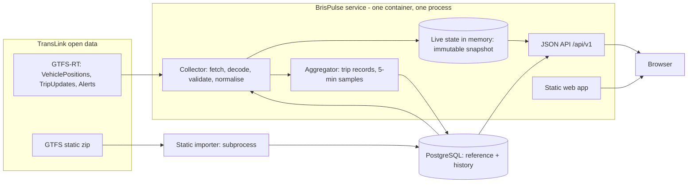

# BrisPulse — Architecture (M1)

**Phase:** M1 — Architecture Validation
**Author:** Fable 5.2
**Date:** 2026-11-16
**Status:** **APPROVED by the product owner on 2026-11-16.** Later the same day the owner decided to release a **live-only** version on free hosting, without stored history: see **§19**, which overrides the sections it names. Contacting TransLink (A6) is still open.

Inputs: [Master Plan](BRISPULSE-MASTER-PLAN.md) · [Audit](BRISPULSE-REPOSITORY-AUDIT.md) · [Data research](BRISPULSE-DATA-SOURCE-RESEARCH.md) · [Metrics](BRISPULSE-METRICS-FEASIBILITY.md) · [MVP requirements](BRISPULSE-MVP-REQUIREMENTS.md) · [Handoff](BRISPULSE-TECHNICAL-HANDOFF.md)

Legend: **[V]** measured in this phase · **[M0]** measured in M0 and re-checked · **[A]** assumption, not verified · **[P]** proposal.

---

## 1. Summary

BrisPulse will be **one small always-on service** that polls TransLink's three GTFS-Realtime feeds, validates and normalises them against the static schedule, keeps the current picture in memory, writes compact history to PostgreSQL, and serves a read-only JSON API plus a single-page web app.

| Decision | Choice | Main reason |
| --- | --- | --- |
| Process model | One always-on process: collector + API together | Polling every 30–60 s and building history needs a process that never sleeps; one process avoids a cache/queue |
| Backend | Python, FastAPI, Pydantic, SQLAlchemy + Alembic, httpx2 (originally httpx; changed in M2.1, see the changelog) | Async polling fits in-process; typed validation and a generated OpenAPI contract |
| Live state | In memory, rebuilt within one poll after restart | It is fully reconstructible from the feeds; persisting it buys nothing |
| Durable storage | PostgreSQL, history and reference data only | History is a real requirement; percentile functions in SQL; standard and explainable |
| Static GTFS | Derived subset, versioned; `stop_times` reduced to one span per trip | 4.67 M rows are not needed at runtime |
| Frontend | React + TypeScript (Vite), MapLibre GL JS, served by the same container | Interactive map of ~1,500 vehicles; one deployable, no CORS |
| Not used | Redis, message queue, microservices, serverless functions, ML | No requirement (Master Plan §6.3) |

## 2. Validation of M0 findings

I re-ran M0's probes on its saved 08:41 snapshot and on a new snapshot taken at 09:03 AEST the same morning, and added three probes (`discovery/probes/m1_*.py`). Still two snapshots from one weekday morning: **nothing here describes typical behaviour over days.**

### 2.1 Confirmed
- **[M0]** Open, unauthenticated, GTFS-RT v2.0, full-dataset feeds; 100 % ID match to static; alerts need `active_period` evaluation (44 of 65 active at 09:03).
- **[V]** Same static zip still published (`Last-Modified` 2026-11-13 19:45 UTC).
- **[V]** Decode is cheap: the 2.06 MB TripUpdates message parses in ~4 ms; the whole analysis peaked at 36 MB RSS. CPU and memory do not drive the design.

### 2.2 Corrected
| M0 statement | Finding | Consequence |
| --- | --- | --- |
| Illustrative delays "median 0 s for all modes" (flagged by M0 as likely biased) | **[V] The bias is real and large.** Trips that have not started and have no vehicle report delay 0 in 94–95 % of cases (870 and 762 trips). Among trips that are actually running, the median next-stop delay was **118 s** in both snapshots (p90 ≈ 500–515 s). | Delay metrics must be computed only over running trips (§6.1). |
| Extreme delays (−6,588 s) "cause unknown" | **[V] Mostly explained.** 322–326 trips had not reached their start time but already had a live vehicle; their "delay" at the first stop had a median of about −26 to −28 minutes. That is a vehicle waiting at its terminus, not an early service. | Exclude not-yet-started trips. A residue remains: 7–8 running trips per snapshot (≈0.7 %) beyond ±30 min, down to −6,519 s. |
| `REPLACEMENT` trips unexplained | **[V]** At 09:03 all 62 were **rail**, on ordinary rail routes (e.g. Varsity Lakes – Airport), and 50 had live vehicles and normal delays. | Treat as running rail trips with a modified pattern; flag, do not drop. Exact TransLink meaning still **[A]**. |
| No cancellations observed | **[V]** One `CANCELED` trip appeared at 09:03. | Cancellations do occur in the feed; count them, but volume is unknown. |
| Python TLS failure "probably environmental" | **[V] Diagnosed.** TransLink serves a normal DigiCert chain (OpenSSL verify OK). The python.org macOS build has no CA bundle configured. | Not a TransLink issue. Use `httpx` (ships `certifi`); CI and container will exercise it. |
| Staleness share | **[V]** Varies between snapshots: vehicles older than 90 s were 3.8 % at 08:41 and 6.4 % at 09:03. | Thresholds must not be tuned to a single snapshot. |

### 2.3 New findings
- **[V] Per-route samples are tiny at any instant.** 397 routes had a live vehicle; the median route had 3, and 195 routes had fewer than 3. A per-route *distribution* from one snapshot is meaningless; it must be built across trips over a day (§6.2).
- **[V] The first stop-time update is the vehicle's current or next stop** for 87 % of trips (1,295 of 1,486); past stops are dropped from the feed. "Next-stop delay" is therefore well defined.
- **[V] Conditional requests:** `If-Modified-Since` returns `304` with no body; `If-None-Match` is ignored (returns 200). Use `If-Modified-Since`.
- **[V] Static processing is small:** streaming all 4,668,624 `stop_times` rows to one span per trip took 6.2 s and 78 MB in plain Python. Rows are contiguous by trip.
- **[V] Service days run past midnight:** 2,779 trips end after 24:00:00, the latest at 30:33. "Today" logic must use the GTFS service date, not the calendar date.
- **[V] A naive "on-time" share would look alarming:** with a −60 s…+300 s band, 60–64 % of running trips were "on time" (bus 57–63 %, rail 86–88 %). Mid-trip predicted delay at an arbitrary stop is not how operators measure punctuality, so this number must never be labelled on-time performance (§6.4).
- **[V] Official comparison data exists:** the Queensland open-data catalogue has "Translink monthly performance data" (22 CSV resources, including Citytrain and tram punctuality; licence CC BY 3.0). Its contents were not read. TransLink's exact on-time thresholds were **not** found.

### 2.4 Third snapshot (09:17 AEST) — independent re-measurement
Taken after approval, to check the figures above against a third moment **[V]**:

| Measure | 08:41 | 09:03 | 09:17 |
| --- | --- | --- | --- |
| Scheduled in-progress trips with a TripUpdate | 92.8 % | not run | 93.5 % (962 of 1,029) |
| … with a VehiclePosition | 91.5 % | not run | 92.0 % (947 of 1,029) |
| Running trips (definition in §6.1) | 1,222 | 1,068 | 992 |
| Median predicted next-stop delay, running trips | 118 s | 118 s | 95 s |
| p90 | 514 s | 501 s | 447 s |
| Share within −60…+300 s | 59.7 % | 64.4 % | 67.7 % |
| Running trips beyond ±30 min | 8 | 7 | 10 |

- Update cadence, my own 75 s run: header timestamps changed every 10–20 s on all three feeds, with one **30 s** gap on VehiclePositions. M0 saw 10–20 s. So a 30 s upstream gap does occur.
- `predicted time − delay` matched the static schedule exactly for 99.8 % of 76,439 events, the same as M0.
- The static zip was unchanged.

All three snapshots fall within 36 minutes of one Monday morning peak. They agree with each other; they say nothing about off-peak, night, weekend or disrupted conditions.

## 3. System overview



### 3.1 Why one process
- The collector must run continuously; a platform that sleeps idle services or only offers daily cron cannot host it. That rules out a serverless-only design.
- With collector and API in one process, the API reads the latest snapshot from memory. A split design would need Redis or a frequently rewritten database row purely to pass ~300 KB of state between processes.
- Cost of this choice: a deploy or crash interrupts collection for seconds, and the service cannot run as multiple replicas. Both are acceptable for an MVP and are stated limits. The collector is a separate module with one interface (`publish(snapshot)`), so it can be moved to its own process later without redesign.

### 3.2 Alternatives considered
| Option | Why not chosen |
| --- | --- |
| Django, web + management-command worker (earlier portfolio proposal; owner knows Django) | Sound, but two processes force live state into the database or a cache, and Django's sync ORM adds little for a read-only JSON API. **Viable fallback if the owner prefers Django.** |
| Next.js on a serverless host + scheduled GitHub Action collector | Scheduled Actions run at best every 5 minutes with unpredictable delay **[A — documented GitHub behaviour, not measured here]**; cannot provide 30–60 s sampling or reliable history. |
| SQLite on a volume | Simplest to run, but lacks built-in percentile aggregates and ties history to one disk. Reasonable if hosting cost forces it. |
| Store every raw feed | ~3 GB/day uncompressed (M0 arithmetic). No requirement justifies it. |

## 4. Components

### 4.1 Collector
| Feed | Poll interval **[P]** | Rationale |
| --- | --- | --- |
| VehiclePositions | 30 s | Upstream refreshes every 10–20 s **[M0]**; 30 s keeps positions inside the 90 s freshness budget |
| TripUpdates | 60 s | Largest payload (≈540 KB gzipped **[V]**); delays change slowly |
| Alerts | 120 s | Small and slow-moving |

All intervals are configuration. At these defaults the service downloads roughly 0.9 GB/day (arithmetic from measured gzipped sizes: 49 KB, 538 KB, 8.8 KB).

Per fetch:
1. `GET` with `Accept-Encoding: gzip`, `If-Modified-Since`, a 10 s timeout, and a `User-Agent` naming the project and its public repository URL (so TransLink can identify and contact the operator).
2. `304` → record `not_modified`, keep current data. `200` → decode Protobuf.
3. **Feed-level checks:** version is `2.0`; header timestamp is not in the future (> 60 s) and not older than the previous one; entity count has not collapsed below 20 % of the trailing median **[P]** (flag `anomaly`, still publish).
4. **Record-level validation** (§5.3). Rejected records are counted by reason, never silently dropped.
5. Build a new immutable snapshot and swap it in atomically. Readers never see a half-updated state.
6. Write one `feed_fetch` row (outcome, timings, counts).

Failures (timeout, non-200, decode error) never clear the current snapshot; it simply ages and its freshness state degrades (§7). Retries use the next scheduled poll; there is no tight retry loop.

### 4.2 Static importer
- A scheduled check (every 6 h **[P]**) issues `HEAD` on `SEQ_GTFS.zip` and compares `Last-Modified`/`ETag` to the active version.
- On change, a **subprocess** downloads the zip, streams the files, and loads a new `static_version` in one transaction: routes, stops, trips (with first departure, last arrival, stop count), calendars. `stop_times` and `shapes` are not stored.
- The main process then switches the active version and reloads its in-memory lookups. If more than 2 % **[P]** of real-time trip IDs fail to resolve after a switch, the service logs an alert and reports `static_mismatch` in `/status`. The old version is kept for 7 days for rollback.
- Route geometry for the map (simplified shape per route and direction) is a deferred M3 option, not part of M2.

### 4.3 Aggregator
Runs inside the collector after each TripUpdates poll.
- **Trip accumulator (memory):** for every running trip (§6.1), append the current next-stop delay. When a trip has been absent from the feed for 10 minutes **[P]**, or at a 5-minute checkpoint, write/update its `trip_record`.
- **Network sample (every 5 min, wall-clock aligned):** one row per mode plus `all`: fresh and stale vehicles, running trips, scheduled in-progress trips, coverage, delay p50/p90, band shares, active alerts.
- **Alert history:** upsert by alert ID and content hash; update `last_seen_at`.
- **Nightly rollup:** `route_day_stats` from `trip_record` for the finished service day; then apply retention.

### 4.4 API and web
FastAPI serves `/api/v1/*` from the in-memory snapshot and from PostgreSQL (history), and serves the built web app as static files. Details in §8.

## 5. Data

### 5.1 PostgreSQL schema **[P]**
| Table | Key | Purpose | Volume (arithmetic) | Retention **[P]** |
| --- | --- | --- | --- | --- |
| `static_version` | id | ETag, last-modified, feed window, counts, active flag | 1 per publish | Last 3 |
| `route`, `stop`, `trip`, `service_calendar`, `service_calendar_date` | (version, id) | Reference data | 553 / 13,125 / 173,183 / 208 / 193 rows per version **[M0]** | With version |
| `feed_fetch` | id | Every fetch: feed, time, HTTP status, outcome, source timestamp, counts, reject reasons, duration | ≈5,000 rows/day | 30 days |
| `network_sample` | (sampled_at, mode) | 5-minute network metrics | 1,440 rows/day | Kept |
| `trip_record` | (service_date, trip_id) | Per-trip delay summary: route, mode, relationship, vehicle, first/last observation, observation count, median, min, max, last delay, late-observation count, excluded-outlier count | ≈20,000 rows/day (20,877 trips scheduled on 2026-11-16 **[M0]**) | 35 days |
| `route_day_stats` | (service_date, route_id) | Trips observed vs scheduled, delay p50/p90 across trips, share late | ≈400 rows/day | Kept |
| `alert_record` | (alert_id, content_hash) | Cause, effect, texts, URL, active periods, route and stop IDs, first/last seen | Tens per day **[A]** | Kept |

Row sizes are not measured; M2 must report actual database size after one week and adjust retention before any plan limit is reached.

### 5.2 In-memory snapshot
`vehicles[]` (id, label, trip, route, mode, lat, lon, status, stop, timestamp, age, fresh flag) · `trips{}` (trip, route, start, relationship, next-stop delay, upcoming stop predictions) · `alerts[]` · per-feed metadata (source timestamp, fetched-at, counts, outcome).

### 5.3 Validation rules
| Rule | On failure |
| --- | --- |
| Latitude/longitude present and inside the SEQ bounding box (−28.5…−25.9, 152.0…153.7 **[P]**, wider than the observed range) | Reject `bad_position` |
| Vehicle timestamp present and not in the future | Reject `bad_timestamp` |
| `trip_id` and `route_id` resolve in the active static version | Keep, mark `unmatched`; exclude from metrics |
| Delay within ±3,600 s **[P]** | Keep for display with a flag; exclude from statistics; count |
| Alert references an unknown stop or route (1 case in M0) | Keep the alert; mark the reference unresolved |
| Trip relationship `CANCELED` | Counted separately; never enters delay statistics |

## 6. Metric definitions **[P — replace the M0 proposals]**

All delay figures are **predicted delay at the next stop**, as published by TransLink. They are not observed arrival times.

### 6.1 Populations
- **Fresh vehicle:** vehicle timestamp no more than **90 s** behind the feed header timestamp. The 90 s figure is the GTFS Realtime best-practice maximum age for vehicle positions (gtfs.org best practices). Vehicles 90 s–15 min old are "last seen" (shown muted, not counted). Older ones are dropped.
- **Running trip:** has a TripUpdate, is not `CANCELED`, has a fresh vehicle, and its service-date start time has passed. At 08:41 this was 1,222 of 2,503 trip updates; at 09:03, 1,068 of 2,293 **[V]**.
- **Scheduled in progress:** from the static schedule and service calendar for the GTFS service date (including yesterday's trips that run past midnight).

### 6.2 Metrics
| Metric | Definition | Shown as |
| --- | --- | --- |
| Active vehicles | Count of fresh vehicles, by mode and route | Number, with the stale count beside it |
| Active alerts | Alerts with an active period containing now; those whose cause is construction or maintenance are labelled planned works. The rest are not claimed to be incidents: live data in M2.4 showed planned timetable changes filed under other causes | Number and list |
| Current network delay | Median and p90 of next-stop delay across running trips, by mode | "Median predicted delay now", with n |
| Delay bands | Share of running trips early (< −60 s), within band, late (> +300 s) **[P defaults; TransLink's official thresholds not verified]** | Stacked bar with n; never called on-time performance |
| Route delay distribution (today) | Distribution of **per-trip median delay** across the route's observed trips for the service day | Histogram plus median/p90; hidden when fewer than 5 trips **[P]** |
| Route "now" | List of the route's running trips with their delays | List, not statistics (median 3 vehicles per route) |
| Real-time coverage | Share of scheduled in-progress trips with a TripUpdate, and with a fresh vehicle, by mode | Percentage with n |
| Disruption statistics | Active alerts by cause and effect; alerts first seen per day (from history) | Counts |
| Trends | Daily series from `route_day_stats` and `network_sample` | Hidden until 7 service days exist **[P]**; chart states the number of days |

No averages are published. Maximum delay appears only in trip lists, flagged when beyond ±3,600 s.

### 6.3 Candidate decisions from M0 (§2.2 of the MVP requirements)
| ID | Recommendation |
| --- | --- |
| C1 Coverage indicator | **Include.** Needs only trip spans, which the importer already produces. |
| C2 Punctuality proxy | **Include as "delay bands"** with the label above. Do not present a single headline percentage. |
| C3 Actual-arrival proxy | **Defer** beyond the MVP. |
| C4 Rail/ferry/tram pages | **Filters only.** |

### 6.4 What must not be claimed
On-time performance, network-wide coverage, crowding, congestion, or any equivalence to TransLink's official punctuality figures.

## 7. Freshness and failure behaviour

Freshness is computed at response time from the feed header timestamp.

| State | VehiclePositions / TripUpdates | Alerts | Behaviour |
| --- | --- | --- | --- |
| `live` | age ≤ 90 s | ≤ 10 min | Normal |
| `delayed` | ≤ 5 min | ≤ 30 min | Data shown; notice |
| `stale` | ≤ 15 min | ≤ 2 h | Data shown with a prominent warning; excluded from history |
| `unavailable` | > 15 min, or never fetched | > 2 h | Live values returned as `null` with a reason; last successful time shown |

The 90 s and 10 min `live` limits follow the GTFS Realtime best practices; the other limits are proposals.

| Failure | Result |
| --- | --- |
| One feed fails | Only that feed degrades; other views keep working |
| All feeds fail | API still answers; states become `stale` then `unavailable`; history views unaffected |
| Database down | Live endpoints still work from memory; history endpoints return `503` with a clear message; collector buffers nothing and logs the gap |
| Process restart | `unavailable` until the first successful poll (≤ 60 s); in-flight trip accumulators are restored from `trip_record` checkpoints |
| Static mismatch | Unmatched records excluded from metrics; `/status` reports it |

A gap in collection is recorded as a gap. Nothing is interpolated or back-filled.

## 8. API contract (v1)

Read-only, JSON, no authentication. Every response uses one envelope:

```json
{
  "data": { },
  "meta": {
    "generated_at": "2026-11-16T09:03:41+10:00",
    "feeds": {
      "vehicle_positions": {
        "state": "live",
        "source_timestamp": "2026-11-16T09:03:20+10:00",
        "fetched_at": "2026-11-16T09:03:25+10:00",
        "age_seconds": 21
      }
    },
    "static_version": "2026-11-13T19:45:24Z",
    "notes": []
  }
}
```

Rules: unavailable values are `null` and explained in `meta.notes`, never `0`; times are ISO 8601 with the Brisbane offset; delays are integer seconds; errors use `{"error": {"code", "message"}}` without internals.

| Endpoint | Returns |
| --- | --- |
| `GET /api/v1/status` | Feed states, last fetch outcomes, static version, coverage, collector health |
| `GET /api/v1/overview` | Active vehicles by mode, active alerts, current delay summary and bands |
| `GET /api/v1/vehicles?mode=&route_id=&bbox=` | Fresh and last-seen vehicles |
| `GET /api/v1/routes?mode=` | Routes with live vehicle count, alert count, today's delay summary |
| `GET /api/v1/routes/{route_id}` | Route detail: running trips, vehicles, alerts, today's distribution |
| `GET /api/v1/trips/{trip_id}` | Upcoming stops with predicted time and delay |
| `GET /api/v1/alerts?active=&route_id=` | Alerts with periods, cause, effect, affected routes and stops |
| `GET /api/v1/analytics/now` | Late trips by route and active alerts by effect and cause, for the present moment. Built in M4 in place of the two endpoints below, which need stored history (§19) |
| ~~`GET /api/v1/analytics/delays?…&window=today`~~, ~~`GET /api/v1/analytics/trends`~~ | Not built: they need stored history, which the live-only release does not keep |
| `GET /api/v1/meta/metrics` | Machine-readable metric definitions and thresholds |
| `GET /healthz` | Process liveness only |

FastAPI generates the OpenAPI document from these models; the frontend's TypeScript types are generated from it, so the contract cannot drift silently.

**Caching:** live endpoints send `Cache-Control: public, max-age=10` and an `ETag` derived from the source timestamps; history endpoints `max-age=300`. No application cache layer.

## 9. Frontend (direction for M3)
React + TypeScript built with Vite; MapLibre GL JS with vehicles as a single GeoJSON source (WebGL handles ~1,500 points without clustering **[A — to verify on a phone in M3]**); polling every 15 s with a query library. Every view renders the five states: loading, empty, delayed/stale, unavailable, error. Basemap tile provider is undecided and must be chosen for licence and cost in M3. The colour scale from the old prototype is not reused until redefined for delay.

## 10. Security and compliance
- No secrets except `DATABASE_URL`; nothing is committed. No user input beyond validated query parameters. No accounts, no personal data.
- CORS disabled (same origin). Basic per-IP rate limiting at the app or proxy **[P]**.
- Attribution to Translink / State of Queensland under CC BY 4.0, a no-endorsement disclaimer, and no Translink logo, on an "About this data" page and in the README.
- Owner action before public launch: email `translink.opendata@tmr.qld.gov.au` to supply contact details and confirm attribution wording (T&C requirement).

## 11. Testing
| Layer | Tests |
| --- | --- |
| Parsing | Real saved feeds (small, attributed) decode; truncated or corrupt payload is rejected |
| Validation | One fixture per hazard: stale vehicle, future timestamp, out-of-bounds position, unmatched trip, ±hour delay, cancelled trip, replacement trip, alert with multiple periods, alert with unknown stop |
| Populations and metrics | Not-started trip with a vehicle is excluded; not-started trip with zero delay is excluded; service day past midnight; percentile math; small-sample suppression |
| Freshness | State transitions at each threshold using a fake clock; `null`-never-zero |
| Collector | 304 handling; timeout; non-200; entity-count collapse; snapshot unchanged after a failure |
| API | Contract tests against the OpenAPI schema; database-down behaviour |
| Frontend (M3) | Component tests for the five states; one end-to-end smoke test |

CI on GitHub Actions: lint, type check, tests with a PostgreSQL service, frontend build, container build.

## 12. Deployment

One Docker image (multi-stage: build the web app, then the Python service). Configuration by environment variables: `DATABASE_URL`, poll intervals, `TRANSLINK_BASE_URL`, `USER_AGENT_CONTACT`, `LOG_LEVEL`.

**Hosting requirements:** an always-on container (no sleep-when-idle), about 512 MB RAM **[A — idle footprint not measured; the heaviest measured job used 78 MB]**, about 1 GB/day of inbound traffic, and PostgreSQL with at least 1 GB.

**Hosting is not decided.** I could not confirm current prices: third-party comparisons from 2026 disagree, and vendor pricing pages were not read. The owner's earlier plan named Railway or Fly.io; both offer always-on containers. A free serverless database that suspends when idle may not suit a writer that never stops; check the plan's compute-hour limit. This needs a decision and a budget from the owner (§13).

## 13. Owner decisions

Decided by the product owner on 2026-11-16.

| ID | Decision | Outcome |
| --- | --- | --- |
| A1 | Backend stack | **Approved:** FastAPI + PostgreSQL |
| A2 | Single always-on process, live state in memory | **Approved** |
| A3 | Metric definitions and thresholds in §6 and §7 | **Approved as starting values;** to be revised after one week of collected data |
| A4 | C1 include · C2 as labelled delay bands · C3 defer · C4 filters | **Approved** |
| A5 | Hosting provider and monthly budget | **Decided 2026-11-16: no paid hosting.** The first release is live-only on a free host that may sleep (§19). Which free host is still to be chosen |
| A6 | Contact TransLink about contact details and attribution | **Open.** Owner action, required before public launch |
| A7 | Monorepo layout: `backend/`, `frontend/`, `docs/`, `discovery/` in this repository | **Approved** |

## 14. M2 plan

| Step | Deliverable | Done when |
| --- | --- | --- |
| M2.1 | Project skeleton, CI, Docker, database migrations | CI green on an empty service |
| M2.2 | Static importer | Loads the live zip; row counts match the file; version switch and rollback tested |
| M2.3 | Collector with validation and freshness | Runs 24 h locally against live feeds; `feed_fetch` shows outcomes; hazard fixtures pass |
| M2.4 | Live API (`status`, `overview`, `vehicles`, `routes`, `trips`, `alerts`) | Contract tests pass; `null`-never-zero proven |
| M2.5 | Aggregator and history tables | `trip_record` and `network_sample` fill; nightly rollup and retention run |
| M2.6 | Deploy the collector early | History accumulates while M3 is built; one-week data review revisits §6 thresholds |

## 15. Risks

| Risk | Mitigation |
| --- | --- |
| Conclusions rest on two snapshots from one morning | M2.3's 24 h run and M2.6's first week are explicit re-validation points |
| TransLink changes or withdraws feeds without notice (T&C) | Schema and count checks; degraded states; documented limitation |
| Delay semantics misread by users | "Predicted" label everywhere; definitions page; no OTP claim |
| Single process: no redundancy | Accepted for MVP; collector is separable |
| Hosting cost or limits | Decide in A5 before M2.6; measure real database growth |
| Static switch breaks ID matching | Versioned import, mismatch detection, rollback |
| Scope creep toward routing or prediction | Out of scope per Master Plan §3.2 |

## 16. Open questions carried forward
1. Behaviour overnight, at weekends and during disruptions (needs collected data).
2. TransLink's official on-time thresholds and whether the monthly performance CSVs can validate BrisPulse's figures.
3. Exact meaning of `REPLACEMENT` trips.
4. How often the static zip is republished and whether IDs break at the switch.
5. Cause of the remaining ±30 min+ predictions on running trips (≈0.7 %).
6. Real memory footprint and database growth of the running service.

## 17. Review of this architecture: weaknesses and missing pieces

A critical pass over the design above, written after approval. Items marked **Gap** are not yet covered anywhere and need a decision or a task.

| # | Weakness | Type | Proposed handling |
| --- | --- | --- | --- |
| W1 | The evidence is three snapshots from 36 minutes of one weekday morning. Every threshold and volume estimate could be wrong for nights, weekends and disruptions. | Risk | The 24 h run (M2.3) and first-week review (M2.6) are mandatory gates, not optional |
| W2 | **No backup or restore plan for PostgreSQL.** Collected history cannot be re-downloaded: upstream keeps none. | **Gap** | Add scheduled database dumps to M2.6 and test one restore; depends on the hosting choice (A5) |
| W3 | Nobody was told when the service stopped. | **Addressed in M5** | A daily smoke check of the live site runs as a GitHub Actions workflow; GitHub emails the owner when a scheduled run fails (DEPLOY.md, Operations). It checks once a day, so an outage can go unnoticed for up to a day |
| W4 | Single process: a crash or deploy stops collection, and up to 5 minutes of per-trip samples are lost between checkpoints. | Accepted limit | Gaps are recorded as gaps; state the limit publicly. Since M2.5 a clean shutdown writes in-flight trips and a start-up resumes them (verified live: 673 resumed, none lost observations); only a crash can lose up to five minutes |
| W5 | Upstream gaps of 30 s were observed. With a 30 s poll, a vehicle position can be about 60 s old on arrival, leaving a thin margin under the 90 s `live` limit; the state may flicker between `live` and `delayed`. | Risk | Partly measured in M2.3: over 323 vehicle-position fetches the data was at most 36 s old when fetched, so with a 30 s poll it stays under about 66 s. No change needed so far; confirm on the 24-hour run |
| W6 | A 60 s TripUpdates poll gives few observations for short trips, so a per-trip median can rest on one or two samples. | Risk | Require a minimum number of observations (3 **[P]**) before a trip enters route statistics; store the count (already in `trip_record`). Implemented in M2.5's rollup |
| W7 | `trip_record` is keyed by service date and trip ID. Whether trip IDs stay stable when the static feed is republished mid-day is unverified. | Assumption | Store the static version on each record (already planned); check at the first observed republish |
| W8 | Retention deletes `trip_record` rows after 35 days. If the nightly rollup was wrong, the source is gone. | Risk | Rollup must be verified against raw rows in tests; delete only days whose rollup exists. Implemented and tested in M2.5 |
| W9 | Memory need (512 MB) and database growth are estimates, not measurements. | Assumption, partly measured | M2.2 measured the static import at about 240 MB peak and 50 MB of database per version. M2.3 measured the running service at 92–100 MB over 4 h 20 min with no growth, and the fetch log at about 2 MB per day. M2.4 raised it to about 140 MB by holding route, stop and trip names in memory. Still to measure: a full day, and history tables (M2.5) |
| W10 | **No rate limiting.** A public, unauthenticated API can be scraped; only cache headers protect it. | Open, accepted | Responses come from memory in milliseconds and carry cache headers. Render's free service offers no proxy-level rate limit, and an in-app limiter would see one shared proxy address. Revisit if abuse appears |
| W11 | The basemap tile provider is undecided; it is a third-party dependency with its own terms and limits. | **Gap** | Decided in M3: OpenFreeMap (OpenStreetMap data, free, no key or account, attribution shown by the map). It has no service guarantee; vehicles still draw if it is unreachable |
| W12 | The web app is served from the same container, with no CDN. | Accepted limit | Fine at MVP traffic; can move to a static host later without API changes if CORS is enabled |
| W13 | Several thresholds (delay bands, anomaly at 20 %, trend minimum of 7 days) are judgement calls. | Assumption | Kept in configuration and published in `/api/v1/meta/metrics`; reviewed after one week |
| W14 | Real feed files used as test fixtures are TransLink data. | Compliance | Keep them small, attribute them in the repository, per CC BY 4.0 |
| W15 | Accessibility and performance budgets. | **Accessibility checked in M5** | axe-core found no violations on any screen in both themes and at phone width (after fixes); structural axe checks run in CI. No formal performance budget: the app's JavaScript is 91 kB compressed, the map 292 kB loaded on demand |

Alternatives are compared in §3.2. The one I would revisit first if hosting cost becomes the constraint is SQLite on a volume, which removes the managed-database cost at the price of in-SQL percentiles.

## 18. What is preserved from existing work

There was no application code to preserve (confirmed by the owner). What carries forward:

| Item | Decision |
| --- | --- |
| Project name and public identity | Kept |
| TransLink GTFS-Realtime as the primary data source (the original concept's first-listed source) | Kept; now the only source in the MVP |
| Python as the backend language (the earlier "Django · Python · GTFS-Realtime" proposal) | Python kept; Django replaced by FastAPI for the reasons in §3.2 |
| M0 documents | Kept unchanged as the discovery record; where M1 supersedes them, a note at the top of the document says so |
| Probe scripts in `discovery/probes/` | Kept; they become the source of test fixtures and the re-validation tools for W1 |
| Prototype screenshot's visual language (dark theme, status colours) | Design reference only; colours must be redefined for delay before reuse |
| Spatial-pressure scoring, calmer-route recommendations, spatial-equity guardrails, Wi-Fi and gate-egress data | Not carried into the MVP (Master Plan §3.2; no verified data). Recorded as the project's origin, for the case study |
| Portfolio page and `/world` scene in the resume repository | Untouched; to be updated by the owner's decision once there is something real to show |

## 19. Live-only deployment (owner decision, 2026-11-16)

### 19.1 The decision
After M2.5 the owner compared hosting costs (about US$5-8 a month for anything that stays on all day) and chose **not to pay for hosting**. The first release is therefore a live dashboard only. This is a change of MVP scope, recorded as Amendment 1 in the Master Plan.

### 19.2 What it changes
| Area | Approved design (§3-§7) | Live-only release |
| --- | --- | --- |
| Host | Always-on container | A free host that stops the service when idle and starts it on a visit |
| Database | PostgreSQL | **None** |
| Schedule | Imported into the database by a subprocess | Read straight from TransLink's zip at start-up, into memory |
| Fetch log | One row per fetch | Not kept; failures still go to the process log |
| History | Trip records, network samples, alerts, daily rollups | **Off** |
| Real-time coverage | From each network sample | **Not available** (it needs trip time spans, which are not loaded) |
| Trends, route statistics | Planned for M4 | **Out of the first release** |
| Live monitoring: vehicles, running trips, predicted delay, alerts, freshness | As designed | **Unchanged** |

### 19.3 How it works
- The service decides its shape from configuration: with no `DATABASE_URL` it runs live-only; with one it runs the full design. No code is removed, so adding a database later restores history without a rewrite.
- At start-up it downloads the schedule zip and reads only `routes.txt`, `stops.txt` and `trips.txt`. `stop_times.txt` (4.67 million rows) is never opened.
- The HTTP application answers immediately and reports that it is loading; the collector looks for the schedule every 2 s and starts polling the moment it is there.
- The API says what it is: `/api/v1/status` has `history_enabled: false`, and the overview's coverage is `null` with a note giving the reason.

### 19.4 Measured (local machine against live TransLink, 2026-11-16 20:28 AEST)
| From process start | Seconds |
| --- | --- |
| HTTP answering | 1.6 |
| Schedule loaded (43 MB download, 553 routes, 13,125 stops, 173,183 trips) | 10.9 |
| All three feeds live | 12.4 |

Memory was about 150 MB. Run as the Docker image with a 256 MB memory limit, the service was live 5.7 s after the container started and used 106 MiB, so a 256 MB instance is enough. A free host's own wake-up time comes on top of this and has not been measured.

### 19.5 Consequences and limits
- **A visitor arriving after an idle period waits** for the host to wake and then about 12 s for data. The web app must show a clear "starting up" state (M3).
- **Nothing accumulates.** No trends can ever be shown from this deployment, and the 24-hour live run planned in §14 does not apply.
- **Polling only happens while the service is awake**, so TransLink is contacted only when someone is using the dashboard.
- The schedule is downloaded on every start. If TransLink's file is unavailable at that moment, the dashboard stays in its loading state and retries every 30 s.
- §17 items W2 (database backups) and W8 (retention) do not apply while there is no database. W3 (nobody is told when collection stops) matters less: there is no history to lose.
- **Not yet chosen or verified:** which free host, its memory limit (the service needs about 150 MB), its wake-up time, and whether it has a region near Australia.

